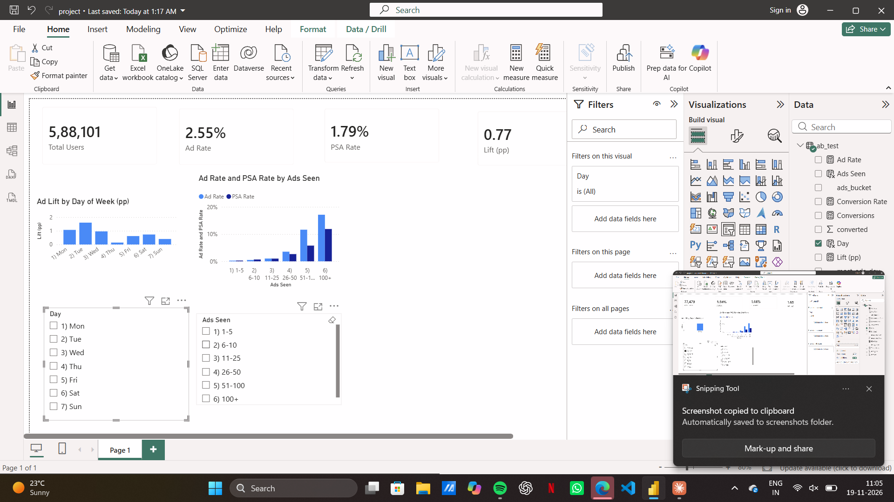
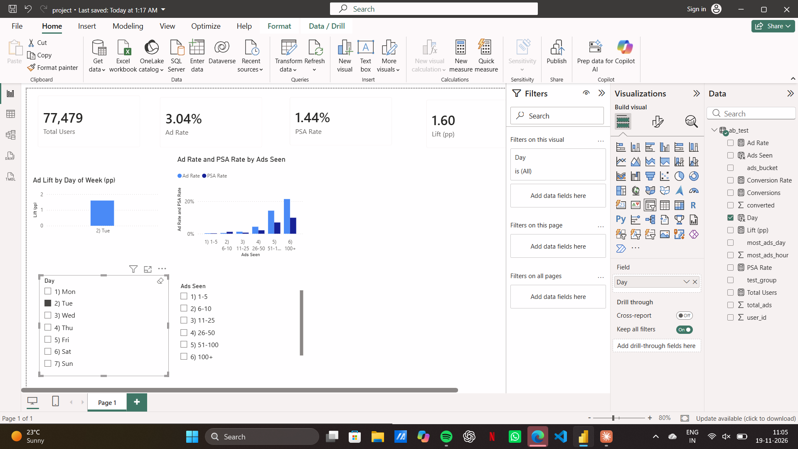
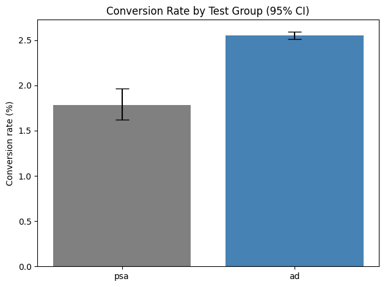
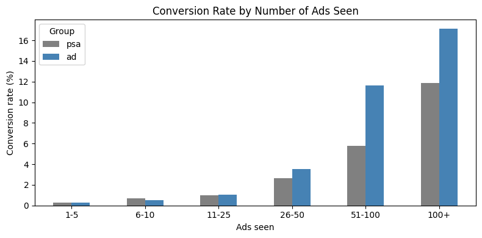

# Marketing A/B Test Analysis

An end-to-end analysis of a marketing A/B test using Python, SQL and Power BI: did the ad campaign really increase conversions, by how much, and for whom?

## Business question
Did users who saw the ad convert at a higher rate than users who saw a neutral public service announcement (PSA), and is the difference real or just chance?

## Dataset
Marketing A/B Testing dataset (Kaggle, FavioVázquez, CC0 public domain): 588,101 users.
Link: https://www.kaggle.com/datasets/faviovaz/marketing-ab-testing

The data file is not included because of its size. Download `marketing_AB.csv` from the link above to reproduce the analysis.

| Column | Meaning |
|---|---|
| user id | Unique user |
| test group | `ad` (saw the ad) or `psa` (control, saw a public service announcement) |
| converted | Whether the user bought |
| total ads | Number of ads the user saw |
| most ads day / hour | When the user saw the most ads |

## Tools
Python (pandas, statsmodels, matplotlib), SQLite, Power BI

## Approach
1. **Python:** dropped a leftover index column, renamed columns, confirmed no duplicate users and no missing values. Compared conversion rates, ran a two-proportion z-test, calculated a 95% confidence interval and converted the lift into business impact.
2. **SQL:** loaded the cleaned data into SQLite and reproduced the results with GROUP BY, CASE and a CTE (conversion by group, by number of ads seen, and by day of week). The numbers match Python.
3. **Power BI:** built an interactive dashboard with KPI cards, an ads-seen chart, a day-of-week chart and slicers.

## Key findings
- **Conversion rates:** ad group **2.55%** (14,423 of 564,577) vs PSA group **1.79%** (420 of 23,524).
- **Lift:** **+0.77 percentage points**, a **43% relative increase**.
- **Statistical significance:** z = 7.37, p ≈ 1.7e-13. The difference is very unlikely to be chance.
- **95% confidence interval:** the true lift is between **0.60 and 0.94 percentage points**.
- **Business impact:** roughly **7,700 extra conversions per 1,000,000 users** (range 6,000 to 9,400).
- **Where the ad works:** the ad and PSA groups converted at about the same rate for users who saw fewer than 26 ads. The advantage appears from 26 ads upward and is largest at 51-100 ads (11.63% vs 5.77%) and 100+ ads (17.14% vs 11.88%).
- **Day of week:** the ad beat the PSA on every day, with the largest gap on Tuesday (+1.60 pp) and the smallest on Thursday (+0.14 pp). Each day has only about 3,400 PSA users, so this is a lead for a follow-up test, not a firm finding.

## Dashboard

## Charts

## Recommendation
Keep running the ad, because it beats the PSA with high confidence. The benefit is concentrated in users who see many ads, so the next test should compare higher and lower ad frequency, or target highly engaged users, to confirm where the lift comes from.

## Limitations
- **Uneven split:** 96% of users were in the ad group and 4% in the PSA group, which is unusual. The data does not say how users were assigned, so the causal conclusion assumes random assignment.
- **Control is a PSA, not "no ad".** The test shows the ad beats a neutral message, not that ads beat showing nothing.
- **Segment results are exploratory.** `total ads` is measured after users enter the test, and engaged users naturally see more ads and convert more, so the pattern shows where the ad's advantage appears, not proof of cause.
- The 6-10 ads bucket shows the ad slightly below the PSA, but that PSA rate rests on about 23 conversions, so I treated it as noise.

## Files
- `notebooks/ab_test_analysis.ipynb`: statistical analysis in Python
- `sql/ab_test_queries.sql`: SQL queries
- `dashboard/ab_test_dashboard.pbix`: Power BI file
- `images/`: dashboard screenshots and charts

## Author
Kabilkumar
